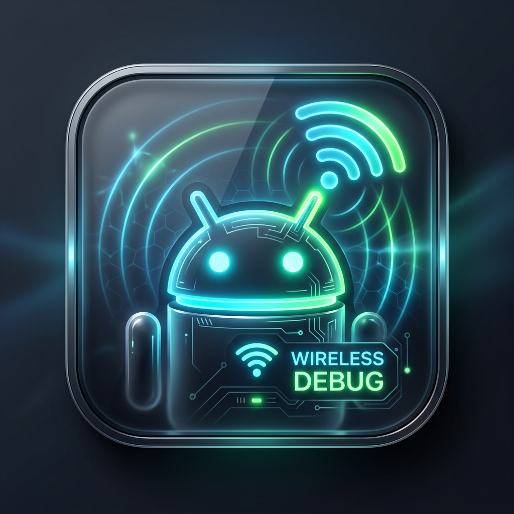
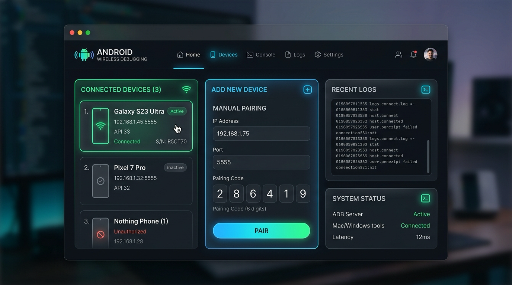

# ⚡ ADB Wireless Debugging Manager

<p align="center">
  
  <br>
  <b>초간편 안드로이드 무선 디버깅 매니저 (Mac & Windows 지원)</b>
  <br>
  <i>Zero Dependencies • mDNS Auto-Discovery • Instant Pairing & Connecting</i>
</p>

<p align="center">
  
  
  
  
</p>

---

<p align="center">
  
</p>

---

## 🌟 개요 (Overview)

**ADB Wireless Debugging Manager**는 안드로이드 11 이상에서 도입된 **무선 디버깅(Wireless Debugging)** 기능을 맥(macOS)과 윈도우(Windows)에서 마우스 클릭 몇 번만으로 손쉽게 페어링하고 연결할 수 있도록 제작된 초경량 웹 대시보드 도구입니다.

복잡한 터미널 명령어(`adb pair`, `adb connect`)나 무거운 안드로이드 스튜디오 실행 없이, 브라우저 화면에서 실시간으로 Wi-Fi 망 내의 기기를 감지하고 즉시 연결할 수 있습니다.

---

## ✨ 핵심 기능 (Key Features)

* **🚀 0 Dependencies (순수 표준 라이브러리)**:
  * 외부 `npm` 패키지 설치(`npm install`)가 전혀 필요 없습니다.
  * Node.js 기본 내장 모듈(`http`, `child_process`, `os`, `fs`)만으로 제작되어 설치 즉시 1초 만에 구동됩니다.
* **💻 완전한 크로스 플랫폼 (macOS & Windows)**:
  * **macOS**: Apple Silicon (M1/M2/M3/M4) 및 Intel Mac 지원, 전용 데스크톱 `.app` 아이콘 제공
  * **Windows**: `start.bat` 더블 클릭 한 번으로 `adb.exe` 경로 자동 탐색 및 브라우저 실행
* **🔍 실시간 mDNS 네트워크 자동 감지**:
  * Wi-Fi 로컬 망 내의 스마트폰 무선 디버깅 브로드캐스트(`_adb-tls-pairing`, `_adb-tls-connect`)를 실시간 감지하여 IP와 포트 번호를 자동으로 채워줍니다.
* **🔑 페어링 코드 스마트 연결**:
  * 폰 팝업의 6자리 페어링 코드를 입력하면 `adb pair`를 수행하고, 성공 즉시 실제 연결 포트로 자동 전환하여 `adb connect`까지 한 번에 완료합니다.
* **📱 실시간 기기 상태 대시보드**:
  * 연결된 스마트폰의 모델명(예: `Galaxy Z Fold 6`, `Galaxy S24`, `Pixel` 등), 시리얼 번호, 연결 상태(device/offline)를 실시간 모니터링합니다.
  * 1-Click [연결 해제], [재연결], [전체 연결 초기화] 지원.

---

## 🚀 빠른 시작 (Quick Start)

### 사전 준비 (Prerequisites)
1. **Node.js** (v16 이상 권장) - [nodejs.org](https://nodejs.org)
2. **Android Debug Bridge (adb)**:
   * **macOS**: `brew install android-platform-tools` 또는 Android Studio
   * **Windows**: Android Studio 또는 Android SDK Platform Tools

---

### 🖥️ Windows (윈도우)
1. 저장소를 다운로드하거나 클론합니다:
   ```cmd
   git clone https://github.com/ugun-byte/adb-wireless-manager.git
   cd adb-wireless-manager
   ```
2. **`start.bat`** 파일을 더블 클릭하여 실행합니다.
3. 브라우저가 자동으로 열리며 `http://localhost:4567`로 접속됩니다.

---

### 🍎 macOS (맥)
1. 저장소를 클론합니다:
   ```bash
   git clone https://github.com/ugun-byte/adb-wireless-manager.git
   cd adb-wireless-manager
   ```
2. 터미널에서 스크립트를 실행합니다:
   ```bash
   chmod +x start.sh
   ./start.sh
   ```
3. 또는 포함된 **`ADB 무선 디버깅.app`**을 바탕화면에 두고 더블 클릭하여 앱처럼 바로 실행할 수 있습니다.

---

## 📖 무선 디버깅 연결 가이드 (Pairing Guide)

안드로이드 11 이상의 무선 디버깅은 보안을 위해 **2개의 서로 다른 포트**를 사용합니다:

```text
[스마트폰 무선 디버깅 설정 화면]
│
├── 1. 메인 설정 화면
│   └── "IP 주소 및 포트" ────────▶ [연결 포트 (Connect Port)] : 디버깅 통신용
│
└── 2. '페어링 코드로 기기 페어링' 터치 시 나타나는 팝업
    ├── "Wi-Fi 페어링 코드 (6자리)" ──▶ [페어링 인증 암호]
    └── "IP 주소 및 포트" ────────▶ [페어링 포트 (Pairing Port)] : 일회성 인증용
```

### 📌 연결 절차 (3단계)
1. 스마트폰에서 **설정 → 개발자 옵션 → 무선 디버깅**을 켭니다. (컴퓨터와 스마트폰이 같은 Wi-Fi에 연결되어 있어야 합니다.)
2. **[페어링 코드로 기기 페어링]** 메뉴를 터치하여 6자리 숫자 팝업창을 띄웁니다.
3. **팝업창을 닫지 않은 상태**에서:
   * 팝업창 안의 **5자리 포트 번호**와 **6자리 페어링 코드**를 웹 대시보드에 입력하고 **[페어링 및 무선 연결 시작]** 버튼을 누릅니다.
4. 페어링이 완료되면 자동으로 기기 목록에 스마트폰이 등록되며 무선 디버깅이 활성화됩니다.

> ⚠️ **주의사항 (자주 발생하는 페어링 실패 원인)**
> * 스마트폰의 **'페어링 코드로 기기 페어링' 팝업창을 닫거나 다른 앱으로 전환하면 해당 코드와 포트는 안드로이드 OS에 의해 즉시 폐기**됩니다.
> * 반드시 팝업창이 화면에 켜져 있는 상태에서 페어링 버튼을 눌러주세요.
> * 무선 디버깅 메인 화면의 포트와 팝업창 안의 포트는 서로 다릅니다. 페어링 시에는 반드시 **팝업창 안의 포트**를 입력해야 합니다.

---

## 🛠️ 내부 구조 (Architecture)

```text
┌─────────────────────────┐
│     Web Dashboard       │  <-- Vanilla JS, CSS3, Glassmorphism UI
│  (http://localhost:4567)│
└────────────┬────────────┘
             │ HTTP REST APIs (/api/status, /api/pair, /api/connect)
┌────────────▼────────────┐
│      Node.js Server     │  <-- Zero dependencies, OS auto-detection
│       (server.js)       │
└────────────┬────────────┘
             │ Child Process Exec
┌────────────▼────────────┐
│     adb (CLI Engine)    │  <-- adb mdns services / adb pair / adb connect
└────────────┬────────────┘
             │ mDNS / TLS 1.3
┌────────────▼────────────┐
│  Android Smartphone     │  <-- Android 11+ Wireless Debugging Daemon
└─────────────────────────┘
```

---

## ❓ 자주 묻는 질문 (FAQ & Troubleshooting)

<details>
<summary><b>Q. 'failed to connect' 오류가 발생합니다.</b></summary>

1. 스마트폰과 맥/PC가 **동일한 Wi-Fi 공유기**에 연결되어 있는지 확인하세요.
2. 카페나 공공 Wi-Fi의 경우 공유기 자체에서 기기 간 통신을 차단하는 **AP Isolation(기기 간 격리)** 기능이 켜져 있을 수 있습니다. 모바일 핫스팟이나 가정용 공유기를 권장합니다.
</details>

<details>
<summary><b>Q. 페어링 후 폰을 껐다 켜거나 Wi-Fi를 다시 연결했을 때는 어떻게 하나요?</b></summary>

한 번 페어링된 기기는 컴퓨터의 RSA 공개키가 폰에 영구 등록되어 있으므로 다시 페어링할 필요가 없습니다.  
웹 대시보드의 **[이미 페어링된 기기 연결]** 탭에서 스마트폰 무선 디버깅 메인 화면에 적힌 포트 번호만 입력하고 **[즉시 무선 연결]**을 누르면 바로 연결됩니다.
</details>

<details>
<summary><b>Q. QR 코드로 페어링하려면 어떻게 하나요?</b></summary>

안드로이드의 QR 코드 무선 페어링은 Android Studio의 전용 TLS 페어링 서버가 필요합니다. 대시보드의 **[QR 코드 페어링]** 탭에서 **[Android Studio QR 열기]** 버튼을 누르시면 Android Studio의 Device Manager 페어링 마법사를 바로 실행할 수 있습니다.
</details>

---

## 📄 라이선스 (License)

This project is licensed under the MIT License - see the [LICENSE](LICENSE) file for details.

© 2026 [ugun-byte](https://github.com/ugun-byte). All rights reserved.
